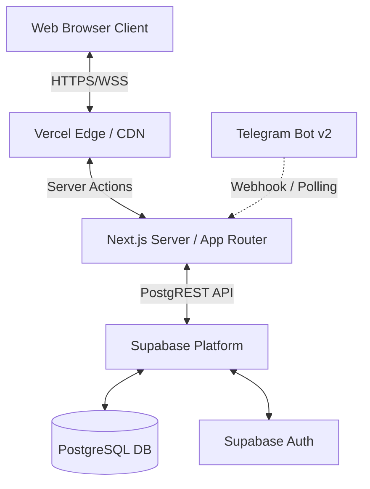

# System Architecture Blueprint

**Project**: RSO Area 1 Project Management Dashboard
**Status**: Approved
**Version**: 1.0

## 1. Executive Summary
Sistem ini menggunakan arsitektur **Monorepo Serverless** berbasis ekosistem **Next.js (App Router)**. Untuk mematuhi batasan *100% Free Tier* dengan keandalan skala *Enterprise*, kita mendesentralisasi beban kerja: UI dan *Routing* ditangani oleh **Vercel Edge Network**, sementara Autentikasi dan *Relational Database* dikelola secara *fully-managed* oleh **Supabase (PostgreSQL)**.

## 2. Architecture Topology (High-Level)

## 3. Technology Stack & Justification
- **Frontend & Backend Framework**: `Next.js 14+ (App Router)` dengan `TypeScript`.
  - *Justifikasi*: Pendekatan *React Server Components (RSC)* mengamankan *credentials* database di sisi server dan mengurangi ukuran *bundle* JavaScript di sisi *client*.
- **Database & Backend-as-a-Service (BaaS)**: `Supabase`.
  - *Justifikasi*: *Free tier* memberikan 500MB *storage* (sangat berlebih untuk 50.000+ baris data teks) dan 50.000 *Monthly Active Users (MAU)*. Supabase mengekspos PostgreSQL menjadi REST API secara instan (PostgREST).
- **UI & Styling**: `Tailwind CSS`, `Shadcn UI`, `TanStack Table`, `Framer Motion`.
  - *Justifikasi*: TanStack Table menangani *client-side processing* untuk 38 kolom secara asinkron tanpa membebani memori server Next.js.
- **Hosting & CI/CD**: `Vercel`.
  - *Justifikasi*: Integrasi *zero-config* dengan repositori GitHub. Menyediakan proteksi DDoS (*Edge Network*) dan *caching* secara gratis.

## 4. Data Flow & State Management
Sistem tidak menggunakan state manager kompleks seperti Redux. Aliran data diatur secara efisien melalui:
1. **Server State**: Pengambilan data dari Supabase dilakukan melalui *React Server Components* (RSC).
2. **Client State (Tabel & Pivot)**: Data JSON mentah dioper ke *Client Component* (TanStack Table & Recharts) untuk *filtering*, *sorting*, dan *pagination* murni di sisi browser. Meminimalisir interaksi berulang ke database yang bisa menghabiskan limit *Free Tier*.
3. **Mutations (CRUD)**: Menggunakan **Next.js Server Actions**. Formulir dikirimkan langsung ke fungsi server, divalidasi dengan `Zod`, lalu di- *push* ke Supabase.

## 5. Authentication & Security (Supabase Auth)
- **Metode**: Email & Password Login.
- **Session Management**: Menggunakan *HTTP-only Cookies* (Supabase SSR) untuk mencegah serangan XSS (*Cross-Site Scripting*).
- **Row Level Security (RLS)**: Diaktifkan pada level PostgreSQL. Secara *default*, operasi `INSERT/UPDATE/DELETE` hanya diizinkan untuk *user* yang memiliki token sesi (JWT) aktif yang tervalidasi.

## 6. Integrasi Masa Depan (v2)
- **Bima/NCX API**: Diletakkan pada *Next.js API Route* terpisah sebagai *proxy* untuk mencegah CORS dan menyembunyikan API Key internal Telkom.
- **Telegram Bot BAPL**: Akan berjalan sebagai *Serverless Function* (Webhook) di Vercel yang menerima *payload* dari Telegram, menyusun dokumen `.docx`, lalu mengirimkan URL unduhannya.

## 7. Disaster Recovery & Availability
- Database di- *backup* otomatis secara harian oleh *Supabase Free Tier*.
- Menggunakan kontrol versi *Git* (GitHub) untuk *rollback* kode UI/UX secara instan melalui Vercel Dashboard jika terjadi kegagalan sistem (*System Failure*).
