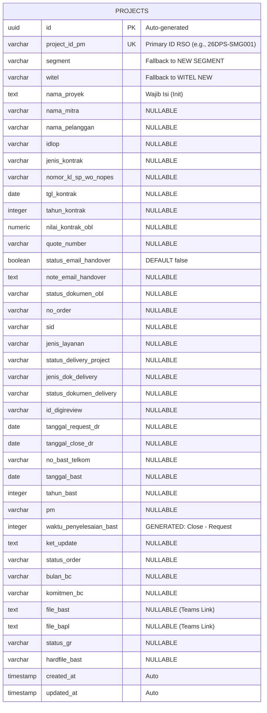

# Entity Relationship Diagram (ERD) & Database Schema

**Project**: RSO Area 1 Project Management Dashboard
**Database Engine**: PostgreSQL (Supabase)
**Paradigm**: Denormalized Master Table (Optimized for Tabular Dashboard Reading)

---

## 1. Relational Map (Mermaid)
Mengingat aplikasi ini adalah *dashboard master tracker*, data disimpan dalam satu *Wide Table* (`projects`) yang flat untuk menghindari latensi `JOIN` yang tidak perlu pada Supabase. Referensi *Dropdown* (Witel, Segment, Status) akan dikelola via *PostgreSQL ENUMs* atau konstan *Frontend* untuk performa maksimal.

## 2. Table Definition: `projects`
**Catatan Nullability**: Sesuai *business requirement*, baris proyek ditambahkan pada fase awal (P8) di mana `Order ID`, `SID`, dan `Tanggal BAST` belum ada. Oleh karena itu, hampir seluruh *field* diizinkan kosong (`NULL`) pada tingkat database.

| Field Name | PostgreSQL Type | Nullable | Constraint / Validation Rule (Zod / RLS) |
| :--- | :--- | :--- | :--- |
| `id` | `UUID` | No | `DEFAULT gen_random_uuid()` |
| `project_id_pm` | `VARCHAR(50)` | No | `UNIQUE`. Format: `[Tahun][Segment]-[Witel][Seq]` |
| `segment` | `VARCHAR(50)` | No | Berasal dari `NEW SEGMENT` CSV. |
| `witel` | `VARCHAR(50)` | No | Berasal dari `WITEL NEW` CSV. |
| `nama_proyek` | `TEXT` | No | Minimal 3 karakter. |
| `status_email_handover` | `BOOLEAN` | Yes | `DEFAULT FALSE`. |
| `note_email_handover` | `TEXT` | Yes | Wajib diisi (Zod) jika `status_email_handover == TRUE`. |
| `status_dokumen_delivery` | `VARCHAR(50)` | Yes | Enum: Evidence, Drafting, Sirkulir, Close. |
| `tanggal_request_dr` | `DATE` | Yes | Wajib diisi (Zod) jika Status Dok Delivery == 'Drafting'. |
| `tanggal_close_dr` | `DATE` | Yes | Wajib diisi (Zod) jika Status Dok Delivery == 'Close'. |
| `waktu_penyelesaian_bast` | `INTEGER` | Yes | Dihitung otomatis: `tanggal_close_dr - tanggal_request_dr`. |
| `file_bast` / `file_bapl` | `TEXT` | Yes | Validasi URL / Path string kosong. |

*(Field lainnya bertipe `VARCHAR(255)`, `TEXT`, `NUMERIC`, atau `DATE` dengan status `NULLABLE` tanpa constraint kaku pada level DB).*

## 3. Data Integrity & Validation Architecture
1. **Level Database (PostgreSQL)**: Hanya menegakkan aturan absolut (Primary Key, Tipe Data Primitif, Unique Constraint pada `project_id_pm`).
2. **Level Backend/Server Actions (Zod Schema)**: Menerapkan aturan dari `Data Dictionary.csv`:
   - *If-Then Validation*: Menolak form submit jika `Status Dok Delivery = Close` tetapi `Tanggal Close DR` kosong.
   - *Calculated Fields*: Menghitung `Waktu Penyelesaian BAST (hari)` sebelum *INSERT/UPDATE* ke Supabase.
3. **Level Row Level Security (RLS)**: 
   - `SELECT`, `INSERT`, `UPDATE`, `DELETE` hanya diizinkan untuk session *Authenticated Users* (Pegawai Telkom PM RSO 1).
